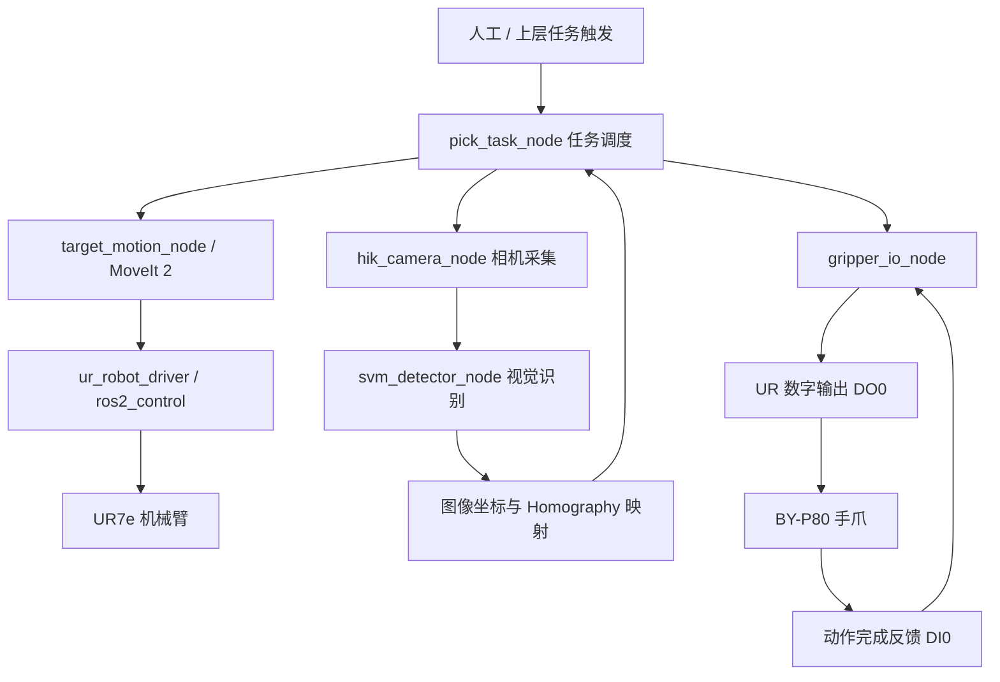

# UR7e + HIK 工业相机 + BY-P80 手爪视觉抓取系统

> **基于 Ubuntu 24.04 / ROS 2 Jazzy / MoveIt 2 的工业机械臂视觉抓取项目开发指南**
>
> 项目仓库：[liarzhip/UR7e_Hicam_BY_control_by_Ros2](https://github.com/liarzhip/UR7e_Hicam_BY_control_by_Ros2)
>
> 本指南依据仓库公开 README（2026-10 查阅）整理，补充环境部署、系统架构、调试步骤、工程注意事项及官方文档。具体消息类型、参数键、服务行为应以当前代码中的接口定义为准。

## 目录

- [1. 项目介绍](#1-项目介绍)
- [2. 硬件与软件环境](#2-硬件与软件环境)
- [3. 整体架构和工作流程](#3-整体架构和工作流程)
- [4. Ubuntu 和 ROS 2 环境搭建](#4-ubuntu-和-ros-2-环境搭建)
- [5. 机械臂与工业相机网络配置](#5-机械臂与工业相机网络配置)
- [6. UR7e 驱动和 MoveIt 2 配置](#6-ur7e-驱动和-moveit-2-配置)
- [7. 工程下载与编译](#7-工程下载与编译)
- [8. ROS 2 节点与接口](#8-ros-2-节点与接口)
- [9. 工业相机与视觉识别](#9-工业相机与视觉识别)
- [10. 手眼映射与 Homography 标定](#10-手眼映射与-homography-标定)
- [11. BY-P80 手爪 I/O 控制](#11-by-p80-手爪-io-控制)
- [12. 启动系统与完成首次抓取](#12-启动系统与完成首次抓取)
- [13. 参数配置与二次开发](#13-参数配置与二次开发)
- [14. 常见故障及排查](#14-常见故障及排查)
- [15. 安全检查与工程建议](#15-安全检查与工程建议)
- [16. 官方开发文档](#16-官方开发文档)

---

## 1. 项目介绍

本项目将 **Universal Robots UR7e 机械臂**、**海康机器人 HIK 工业相机**和 **BY-P80 电动手爪**集成为一套基于 ROS 2 的自动化视觉抓取系统。上层通过 MoveIt 2 完成运动规划，下层借助 Universal Robots ROS 2 Driver 完成轨迹执行、机器人状态反馈和控制器 I/O 交互。

项目的主要功能：

1. UR7e 的外部 ROS 2 连接、关节状态监控与运动规划。
2. 使用工业相机按需采集目标图像（仓库配置为一次触发采集 5 帧）。
3. 基于轮廓、HOG、Hu 矩、几何特征和 SVM 完成目标识别与稳定定位。
4. 通过平面单应矩阵（Homography）将图像坐标映射到工作平面坐标。
5. 通过机器人数字量输出控制 BY-P80 手爪，并读取动作完成反馈。
6. 利用抓取任务节点协调回 Home、拍照、识别、接近、抓取、抬升及返回。

**项目定位：** 一套适用于教学、科研、视觉抓取验证及 ROS 2 工业机器人二次开发的基础平台。它不是经过安全认证的无人值守生产控制系统。

## 2. 硬件与软件环境

### 2.1 硬件组成

| 设备 | 型号 / 方案 | 作用 |
|---|---|---|
| 六轴工业机械臂 | UR7e | 执行运动与抓取 |
| 工业相机 | 海康机器人 MV-CU060-10GC（当前开发配置） | 工作台目标拍摄 |
| 电动手爪 | BY-P80 | 开合抓取 |
| 工控机 / 开发 PC | Ubuntu 主机 | 运行 ROS 2、规划和视觉节点 |
| 工业网线与以太网接口 | 建议分别连接机械臂与相机 | 独立通讯网络 |
| 手爪信号线 | DO0 控制、DI0 反馈及公共参考连接 | 机器人与夹爪 I/O 联动 |

**重要：** 接线前核实手爪控制器和 UR 控制柜的输入输出电气规格、公共端及信号电平；不可仅凭逻辑接口名称接线。

### 2.2 推荐软件栈

| 组件 | 版本或用途 |
|---|---|
| Ubuntu | 24.04 LTS |
| ROS 2 | Jazzy Jalisco |
| MoveIt | MoveIt 2（Jazzy 版本） |
| UR Driver | `ur_robot_driver` |
| 控制框架 | `ros2_control` |
| 工业相机 SDK | HIK MVS Linux SDK（与 CPU 架构、系统及相机兼容的版本） |
| 图像处理 | OpenCV |
| 机器学习 | SVM（具体运行时依仓库实现） |
| 构建工具 | colcon、CMake、rosdep |
| 开发工具 | VS Code、RViz 2、rqt_image_view |

## 3. 整体架构和工作流程



**典型抓取状态机：**

```text
/pick/start
    ↓
机械臂回到 HOME 并等待稳定
    ↓
触发 /hik_camera/run_once
    ↓
采集连续 5 帧图像
    ↓
SVM 识别与多帧稳定定位
    ↓
发布 /vision/target_pose
    ↓
打开手爪 → PREGRASP → GRASP
    ↓
闭合手爪 → 等待 DI0 反馈
    ↓
LIFT → HOME → 任务完成
```

建议把相机丢帧、目标置信度不足、规划失败、机械臂状态异常、手爪反馈超时等视为明确的任务失败状态，而不是继续执行。

## 4. Ubuntu 和 ROS 2 环境搭建

### 4.1 安装 ROS 2 Jazzy

推荐严格遵循 ROS 官方安装文档配置软件源，再安装桌面版：

- [ROS 2 Jazzy — Ubuntu deb 安装官方指南](https://docs.ros.org/en/jazzy/Installation/Ubuntu-Install-Debs.html)

完成官方软件源配置后：

```bash
sudo apt update
sudo apt install -y ros-jazzy-desktop ros-dev-tools
source /opt/ros/jazzy/setup.bash
ros2 --help
```

建议在 `~/.bashrc` 中添加（避免重复追加）：

```bash
grep -qxF 'source /opt/ros/jazzy/setup.bash' ~/.bashrc || \
  echo 'source /opt/ros/jazzy/setup.bash' >> ~/.bashrc
```

安装工程构建工具和常用 ROS 工具：

```bash
sudo apt install -y \
  git build-essential cmake \
  python3-colcon-common-extensions \
  python3-rosdep python3-vcstool \
  ros-jazzy-moveit \
  ros-jazzy-ros2-control ros-jazzy-ros2-controllers \
  ros-jazzy-rqt-image-view
```

如果当前系统尚未初始化 rosdep：

```bash
sudo rosdep init
rosdep update
```

若 `rosdep init` 提示已存在配置，直接执行 `rosdep update` 即可。

### 4.2 ROS 2 基础验证

新终端运行：

```bash
source /opt/ros/jazzy/setup.bash
ros2 pkg list | grep -E 'moveit|rqt_image_view'
```

可运行官方 talker/listener 示例检查基础通信环境；注意两端须使用相容的 ROS_DOMAIN_ID 与 RMW 配置。

### 4.3 Python 环境注意事项

ROS 2 Jazzy 的系统 Python 依赖 Ubuntu 自带环境。对于直接依赖 `rclpy` 或系统安装的 ROS 包的节点，优先使用系统 Python；第三方视觉训练环境可另建虚拟环境，但应避免使用不兼容的 NumPy/OpenCV 覆盖 ROS 二进制包依赖。HIK MVS SDK 往往还需要设置专用动态库路径，应按所安装的 SDK 官方说明配置。

## 5. 机械臂与工业相机网络配置

### 5.1 本项目 IP 规划

仓库 README 当前采用两组网段：

| 设备 / 端口 | IPv4 地址 | 说明 |
|---|---|---|
| UR7e 控制器 | `192.168.0.10` | 示教器网络设置 |
| Ubuntu 机械臂网口 | `192.168.0.11` | UR Driver 主机 |
| HIK 工业相机 | `192.168.1.20` | GigE 相机 |
| Ubuntu 相机网口 | `192.168.1.21` | GigE 图像采集 |

建议两个网口分别配置 `/24` 掩码（`255.255.255.0`），无特殊需求不为直连设备端口设置默认网关，避免扰乱上网路由。

先查询 Linux 网卡名称：

```bash
ip -br addr
nmcli device status
```

可以在 Ubuntu 设置 → 网络界面中为两个有线网口分别指定静态 IPv4；或使用 NetworkManager 配置正确的连接名。**不要把示例接口名直接当作真实网卡名。**

检查连通性：

```bash
ping -c 4 192.168.0.10
ping -c 4 192.168.1.20
ip route
```

`ping` 成功只说明网络基本通畅，不能证明 UR 外部控制程序或 HIK 图像流已经正常运行。

### 5.2 UR7e 示教器准备

1. 确认机械臂处于安全可运行状态，急停解除，机器人已完成上电和使能。
2. 按 UR 官方说明安装与控制器软件兼容的 **External Control URCap**。
3. 在示教器中添加 External Control 程序节点。
4. 将 External Control 节点的 Host IP 配置为 Ubuntu 网口 IP（本项目为 `192.168.0.11`）。
5. 启动 ROS 端驱动后，再按程序流程运行示教器上的外部控制节点。

官方说明：[UR Robot Setup](https://docs.universal-robots.com/Universal_Robots_ROS_Documentation/jazzy/doc/ur_robot_driver/ur_robot_driver/doc/installation/robot_setup.html)。

> 不同控制器版本与示教器界面可能有所不同，请优先服从对应 UR 官方手册。第一次接入前，确保急停、保护停止、工作空间和运行速度设置正确。

## 6. UR7e 驱动和 MoveIt 2 配置

### 6.1 安装 UR ROS 2 Driver

优先安装官方已发布二进制包：

```bash
sudo apt update
sudo apt install -y ros-jazzy-ur
```

官方安装指南：[Installation of ur_robot_driver](https://docs.universal-robots.com/Universal_Robots_ROS_Documentation/jazzy/doc/ur_robot_driver/ur_robot_driver/doc/installation/installation.html)。

### 6.2 建议提取出厂运动学校准参数

UR 官方特别建议提取每台机器人独有的出厂校准数据，避免 ROS 模型与实机运动学产生明显偏差。机械臂通电并与开发机连通后执行：

```bash
mkdir -p ~/UR7e/calibration
ros2 launch ur_calibration calibration_correction.launch.py \
  robot_ip:=192.168.0.10 \
  target_filename:="${HOME}/UR7e/calibration/ur7e_calibration.yaml"
```

之后检查 `scripts/start_driver.sh` 是否通过 `kinematics_params_file` 向驱动加载了该文件；若未加载，应参照官方驱动启动参数说明调整。校准文件与具体机器人一一对应，不宜跨设备直接复用。

官方依据：[UR Driver Robot Setup / Calibration](https://docs.universal-robots.com/Universal_Robots_ROS_Documentation/jazzy/doc/ur_robot_driver/ur_robot_driver/doc/installation/robot_setup.html)。

### 6.3 驱动启动

本项目提供了封装脚本（推荐）：

```bash
cd ~/UR7e
source /opt/ros/jazzy/setup.bash
source ~/UR7e/ros2_ws/install/setup.bash
./scripts/start_driver.sh
```

如果仅验证官方驱动，可使用（确认安装版本支持 `ur7e`）：

```bash
ros2 launch ur_robot_driver ur_control.launch.py \
  ur_type:=ur7e robot_ip:=192.168.0.10
```

**两种启动方式二选一**，不要同时运行两套硬件驱动。官方启动方法：[Startup the driver](https://docs.universal-robots.com/Universal_Robots_ROS_Documentation/jazzy/doc/ur_robot_driver/ur_robot_driver/doc/usage/startup.html)。

在示教器中运行 External Control 程序，检查：

```bash
ros2 topic echo \
  /io_and_status_controller/robot_program_running --once
```

预期：

```yaml
data: true
```

再查看系统状态：

```bash
ros2 node list
ros2 control list_controllers
ros2 topic list
ros2 topic echo /joint_states --once
```

`robot_program_running=true` 是机器人侧程序运行的重要判据，但不代替安全状态和控制器状态检查。

### 6.4 MoveIt 2 运动规划

使用项目封装脚本：

```bash
cd ~/UR7e
source /opt/ros/jazzy/setup.bash
source ~/UR7e/ros2_ws/install/setup.bash
./scripts/start_moveit.sh
```

MoveIt 2 负责机器人模型、正逆运动学、轨迹规划及规划场景交互，RViz 主要负责可视化与交互。它**不等同于单独的逆运动学求解器**。

**操作约束：** 当自动抓取节点正在控制机器人时，不要在 RViz 中同时点击 `Plan & Execute` 或 `Execute`，避免多个命令源竞争控制机械臂。

官方文档：[MoveIt 2](https://moveit.picknik.ai/main/index.html) · [二进制安装](https://moveit.ai/install-moveit2/binary/)。

## 7. 工程下载与编译

### 7.1 克隆项目

仓库原始 README 使用 `~/UR7e` 作为工作目录，建议保持这个路径，以免脚本和 YAML 中使用的路径失效：

```bash
cd ~
git clone https://github.com/liarzhip/UR7e_Hicam_BY_control_by_Ros2.git UR7e
cd ~/UR7e
```

若已经有本地项目，不要重复克隆覆盖；先检查 `git status`，保留现场标定与配置文件。

### 7.2 工作空间说明

已在仓库首页确认的顶层目录包括：

```text
UR7e/
├── README.md
├── ros2_ws/            # ROS 2 工作空间
├── scripts/            # Driver / MoveIt 启动脚本
├── calibration/        # 标定相关文件
├── config/             # 项目配置
├── Realsense/          # 扩展模块目录（不属于本指南的核心启动链）
├── image/              # 图像与项目资料
├── build/              # 构建产物
├── install/            # 安装产物
└── log/                # 日志
```

README 中实际使用的软件包路径：

```text
ros2_ws/src/ur7e_motion/config/motion.yaml
ros2_ws/src/ur7e_vision/config/vision.yaml
```

**注意：** 顶层 `build/install/log` 与工作空间 `ros2_ws` 内构建目录可能同时存在，以实际运行的 `colcon` 工作目录为准。

### 7.3 编译工作空间

```bash
source /opt/ros/jazzy/setup.bash
cd ~/UR7e/ros2_ws

# 自动安装能够由 rosdep 解析的 ROS 包依赖
rosdep install --from-paths src --ignore-src -r -y --rosdistro jazzy

# 首次建议完整编译
colcon build --symlink-install
source install/setup.bash
```

若仅修改运动或视觉模块 C++ 源码：

```bash
cd ~/UR7e/ros2_ws
colcon build --packages-select ur7e_motion ur7e_vision --symlink-install
source install/setup.bash
```

修改 `target_motion_node.cpp`、`gripper_io_node.cpp`、`pick_task_node.cpp` 或 `CMakeLists.txt` 后，通常需要重新构建。修改 `motion.yaml` / `vision.yaml` 并使用源码路径传参时，一般只需要重启节点；如果修改其他已安装文件或使用安装路径配置，则需检查配置是否已同步到安装空间。

**依赖提醒：** `rosdep` 无法自动代替 HIK 专有 MVS SDK 的安装；还可能需要根据源码额外安装 OpenCV、SVM 模型运行所需依赖。

## 8. ROS 2 节点与接口

### 8.1 运动节点 `target_motion_node`

```bash
ros2 run ur7e_motion target_motion_node \
  --ros-args --params-file \
  ~/UR7e/ros2_ws/src/ur7e_motion/config/motion.yaml
```

仓库 README 描述了这些运动相关接口：

| 接口名称 | 用途 |
|---|---|
| `/ur7e/plan_to_target` | 规划到目标位姿 |
| `/ur7e/execute_last_plan` | 执行上一次规划 |
| `/ur7e/move_to_target` | 规划并移动到目标 |
| `/ur7e/set_home_here` | 记录当前位置为 Home 候选 |
| `/ur7e/home_status` | 查询 Home 状态 |
| `/ur7e/plan_home` | 规划回 Home |
| `/ur7e/go_home` | 回 Home |
| `/ur7e/stop` | 停止当前运动流程 |

上述接口应通过以下命令查询真实类型：

```bash
ros2 service list -t | grep -E '/ur7e|/pick|/gripper'
ros2 topic list -t | grep -E '/ur7e|/vision|/hik_camera'
ros2 service type /ur7e/go_home
```

**示例：标定 Home**（仓库 README 使用 `std_srvs/srv/Trigger`）：

```bash
ros2 service call /ur7e/set_home_here std_srvs/srv/Trigger '{}'
```

将返回的 6 个关节值妥善写入 `motion.yaml` 中对应 Home 参数后，再在低速和安全环境下测试：

```bash
ros2 service call /ur7e/go_home std_srvs/srv/Trigger '{}'
```

**不要默认 `set_home_here` 会把结果永久保存到 YAML。**

### 8.2 相机节点 `hik_camera_node`

```bash
ros2 run ur7e_vision hik_camera_node \
  --ros-args --params-file \
  ~/UR7e/ros2_ws/src/ur7e_vision/config/vision.yaml
```

手动触发 5 帧采集：

```bash
ros2 topic pub --once /hik_camera/run_once std_msgs/msg/Empty '{}'
```

README 中成功时的预期日志包含 `Burst frame 1/5 published` 至 `Burst frame 5/5 published`、`success=True`。通过下列命令确认图像话题：

```bash
ros2 topic list -t | grep -E 'image|camera'
ros2 run rqt_image_view rqt_image_view
```

### 8.3 SVM 视觉节点 `svm_detector_node`

```bash
ros2 run ur7e_vision svm_detector_node \
  --ros-args --params-file \
  ~/UR7e/ros2_ws/src/ur7e_vision/config/vision.yaml
```

README 记录的输出话题：

| 话题 | 用途 |
|---|---|
| `/vision/target_pose` | 目标位置 / 位姿结果 |
| `/vision/target_class` | 目标分类结果 |
| `/vision/debug_image` | 视觉中间结果可视化 |

查看类型及数据：

```bash
ros2 topic info /vision/target_pose -v
ros2 topic echo /vision/target_pose --once
ros2 topic hz /vision/debug_image
```

### 8.4 手爪节点 `gripper_io_node`

```bash
ros2 run ur7e_motion gripper_io_node \
  --ros-args --params-file \
  ~/UR7e/ros2_ws/src/ur7e_motion/config/motion.yaml
```

状态查询：

```bash
ros2 service call /gripper/status std_srvs/srv/Trigger '{}'
```

闭合指令：

```bash
ros2 service call /gripper/close std_srvs/srv/Trigger '{}'
```

请先使用 `ros2 service list -t | grep gripper` 确认**张开手爪**对应的实际服务名称；README 中没有给出明确的 `/gripper/open` 调用示例，不能在未经确认时当成已实现接口。

### 8.5 任务节点 `pick_task_node`

```bash
ros2 run ur7e_motion pick_task_node \
  --ros-args --params-file \
  ~/UR7e/ros2_ws/src/ur7e_motion/config/motion.yaml
```

开始任务：

```bash
ros2 service call /pick/start std_srvs/srv/Trigger '{}'
```

停止任务：

```bash
ros2 service call /pick/stop std_srvs/srv/Trigger '{}'
```

任务级 stop 不是安全急停的替代品；涉及人员、设备安全的情形应使用现场合规安全回路。

## 9. 工业相机与视觉识别

### 9.1 HIK MVS 安装

1. 通过海康机器人官方网站获取适用于 Linux 的 MVS SDK。
2. 核对 Ubuntu/CPU 架构（x86_64 或 aarch64）及相机兼容性。
3. 按 SDK 安装说明完成驱动、运行库和环境变量配置。
4. 使用 MVS 官方工具确认相机在线、曝光正常、连续采图稳定，再启动 ROS 2 相机节点。

官方网站：[HIKROBOT 海康机器人](https://www.hikrobotics.com/)。可从其机器视觉软件/下载支持入口查找 **MVS**；下载入口与版本可能因地区变化。

### 9.2 视觉处理链

仓库 README 给出的视觉算法链：


这里 SVM 负责基于手工特征的分类，几何中心 / 轮廓计算用于目标定位，Homography 将定位结果映射至机器人工作平面。务必检查分类模型是否与当前光照、背景、相机视角及目标种类一致。

### 9.3 验证流程

1. MVS 能稳定取图。
2. `hik_camera_node` 成功收到 `run_once`。
3. `rqt_image_view` 能显示图像。
4. `svm_detector_node` 输出调试图像和目标类别。
5. `/vision/target_pose` 的坐标单位、参考坐标系及方向与抓取任务期望一致。

没有经过坐标检查时，禁止直接把视觉结果发送为真实抓取目标。

## 10. 手眼映射与 Homography 标定

### 10.1 原理

固定相机拍摄近似平面的工件时，可使用 3×3 Homography 把图像像素 `(u,v)` 映射到工作平面坐标 `(x,y)`：

$$
\begin{bmatrix} \tilde{x} \\ \tilde{y} \\ w \end{bmatrix}
= H\begin{bmatrix}u\\v\\1\end{bmatrix}, \qquad
x=\tilde{x}/w, \quad y=\tilde{y}/w
$$

本项目 README 中展示的标定记录为 **18 个点**、平均 XY 误差约 **0.000925 m**、最大 XY 误差约 **0.002870 m**。这些数值仅对应当时的标定数据，不代表更换安装位置、光学设置或工件高度后仍具有相同性能。

### 10.2 推荐标定步骤

1. 固定相机和标定平面，记录相机曝光、焦距、分辨率及安装方式。
2. 在实际抓取工作平面内布设均匀分布且不少于 4 个非共线的对应点；推荐使用更多点覆盖整个有效工作区。
3. 采集像素点 `(u,v)` 与工作平面物理坐标 `(x,y)`，**明确输出坐标系与单位**。
4. 使用 OpenCV `findHomography()` 估计矩阵，必要时结合 RANSAC 去除异常点。
5. 保存至 `homography.yaml`，并对未参加拟合的验证点统计误差。
6. 先在不抓取、不下降的情况下验证映射位置，再进行小范围低速抓取测试。

官方教程：[OpenCV Homography](https://docs.opencv.org/4.x/d9/dab/tutorial_homography.html) · [OpenCV 特征匹配与单应变换](https://docs.opencv.org/4.x/d7/dff/tutorial_feature_homography.html)。

### 10.3 `homography.yaml` 的结构

仓库 README 展示的配置结构为：

```yaml
homography:
  rows: 3
  cols: 3
  data: [h11, h12, h13, h21, h22, h23, h31, h32, h33]
calibration:
  point_count: 18
  mean_xy_error_m: 0.0009254134903210749
  max_xy_error_m: 0.002870496919034476
```

上面的 `h11...h33` 是**占位符**，必须替换成在现场标定得到的数值；不可作为可运行参数。实际文件位置、加载方式请以当前代码为准。

**适用边界：** Homography 可解决同一工作平面上的 XY 映射，**不能单独获得任意物体的完整三维位姿**，也不能自动处理高度变化与工具姿态。如果相机移位、变焦或工作平面发生变化，需重新标定。

## 11. BY-P80 手爪 I/O 控制

仓库当前逻辑：

| UR 信号 | 连接对象 | 逻辑 |
|---|---|---|
| DO0 | BY-P80 控制输入 | ON → 打开；OFF → 闭合 |
| DI0 | BY-P80 完成输出 | 手爪动作完成反馈 |

**说明：** 以上是当前工程的软件逻辑映射，不代表 BY-P80 在所有硬件设置中的默认极性。必须结合手爪控制器实际模式、有效电平、动作完成信号类型进行确认。

典型控制过程：

```text
任务下发 OPEN / CLOSE
        ↓
gripper_io_node 更新 DO0
        ↓
手爪控制器执行动作
        ↓
手爪完成信号返回 DI0
        ↓
ROS 节点检查到位 / 超时状态
        ↓
向任务状态机返回结果
```

建议增加 DI0 边沿/电平语义核对、最大动作等待时间、超时故障处理和上电默认输出状态检查。若控制器的“动作完成”只是运动结束，不代表成功夹紧，应另外确认夹持成功条件。

## 12. 启动系统与完成首次抓取

**启动前提：** 机械臂及相机 IP 正确，URCap 已设置，MVS SDK 可取图，ROS 工作空间完成编译，标定与 Home 配置已经检查。

每个步骤在**独立终端**执行；推荐依下列顺序：

| 顺序 | 终端 | 操作 |
|---|---|---|
| 1 | T1 | `./scripts/start_driver.sh` |
| 2 | 示教器 | 运行 External Control 程序，确认 `robot_program_running=true` |
| 3 | T2 | `./scripts/start_moveit.sh` |
| 4 | T3 | `target_motion_node` |
| 5 | T4 | `gripper_io_node` |
| 6 | T5 | `hik_camera_node` |
| 7 | T6 | `svm_detector_node` |
| 8 | T7 | `pick_task_node` |
| 9 | T8 | 检查全部必需节点、目标位姿与手爪状态 |
| 10 | T8 | `ros2 service call /pick/start std_srvs/srv/Trigger '{}'` |

通用终端初始化：

```bash
source /opt/ros/jazzy/setup.bash
source ~/UR7e/ros2_ws/install/setup.bash
```

首次联调应分阶段进行：

1. **通讯测试：** 只看关节状态、IO 状态，不控制运动。
2. **规划测试：** 在 RViz 检查规划路径和碰撞情况。
3. **空载运动：** 低速回 Home，小范围到达已知安全位姿。
4. **手爪测试：** 不夹物体时检查开合与 DI0 状态。
5. **视觉测试：** 手动触发相机，核查目标像素与实际 XY 坐标。
6. **抓取测试：** 在安全区域、低速下完成单次完整流程。

执行前确认目标高度、末端工具 TCP、夹爪夹持宽度、抓取姿态和安全抬升高度。

## 13. 参数配置与二次开发

### 13.1 主要配置入口

| 配置位置 | 重点检查内容 |
|---|---|
| `ros2_ws/src/ur7e_motion/config/motion.yaml` | Home 关节值、运动与抓取参数、手爪配置 |
| `ros2_ws/src/ur7e_vision/config/vision.yaml` | 相机与视觉检测相关参数 |
| `homography.yaml`（实际位置以源码为准） | 标定矩阵与误差记录 |
| `scripts/start_driver.sh` | 机械臂型号、IP 与 UR 驱动启动参数 |
| `scripts/start_moveit.sh` | MoveIt 2 启动参数 |

查询节点的实际参数：

```bash
ros2 param list /target_motion_node
ros2 param list /hik_camera_node
```

注意节点名可能与可执行文件名不同，先用 `ros2 node list` 确认。

### 13.2 推荐的工程扩展方向

- **集成 launch：** 把多个节点整合进一个 launch 文件，并显式管理启动依赖和启动失败行为。
- **状态机管理：** 为自动抓取引入任务阶段、超时、取消、恢复和故障码。
- **视觉升级：** 用 YOLO 检测 / 实例分割补充现有 SVM 流程，并保留坐标映射与置信度检查。
- **深度相机：** 将 RealSense 作为可选二阶段精定位传感器；需新增外参、TF 和三维姿态估计，不能直接复用固定俯视相机的 Homography。
- **硬件参数版本管理：** 将标定文件和设备参数与机器人序列、相机标识、标定日期绑定，防止使用错误版本。
- **运行记录：** 对抓取成功率、规划耗时、相机检测时间、手爪反馈超时进行日志统计。

## 14. 常见故障及排查

### 14.1 机械臂 IP 可以 ping 通，但 ROS 不能控制

按顺序检查：

```bash
ping -c 4 192.168.0.10
ros2 node list
ros2 control list_controllers
ros2 topic echo /io_and_status_controller/robot_program_running --once
```

检查 External Control URCap 是否安装、示教器 Host IP 是否为 `192.168.0.11`、外部控制程序是否真正运行、驱动是否重复启动。网络可达不等于 External Control 已建立。

### 14.2 已执行到位，但程序提示等待超时

可能与控制器状态、关节/末端容差、最终轨迹完成确认、时间戳、等待逻辑或状态更新滞后相关。建议同时记录：

```bash
ros2 topic echo /joint_states
ros2 control list_controllers
ros2 topic echo /tcp_pose_broadcaster/pose --once
```

比较**目标**与**实际**的关节位置及末端位姿，检查目标容差和超时阈值。不要仅因为肉眼看到机器人停止就判定控制程序已达到成功条件。

### 14.3 相机无法发现或图像丢帧

- 检查相机与 Ubuntu 是否处于 `192.168.1.0/24` 网段。
- 使用 MVS 查看是否能稳定采图。
- 检查网卡接口是否选错、SDK 路径、GigE 网络带宽与数据包设置。
- 若使用大图像或多帧采集，检查丢包、缓冲和 CPU 处理速度。
- 不要在多个进程中不受控地同时独占相机设备。

### 14.4 `ros2 run` 找不到节点

```bash
source /opt/ros/jazzy/setup.bash
source ~/UR7e/ros2_ws/install/setup.bash
ros2 pkg executables ur7e_motion
ros2 pkg executables ur7e_vision
```

若不存在，检查包目录、`CMakeLists.txt` 安装规则及 `colcon build` 日志。

### 14.5 手爪不动作或错误等待反馈

确认 DO0 实际电平、电气公共端、控制器模式和 DI0 逻辑；分别做无负载开合测试。若 DO0 已变化但 DI0 未更新，检查手爪实际是否完成、反馈延迟、输入是否为脉冲及 I/O 映射是否正确。

### 14.6 视觉坐标有系统性偏差

检查相机固定位置、图像缩放/裁剪、镜头变焦、工作平面高度、标定坐标系、XY 偏置、工具 TCP 及轴方向。系统性偏差可能源于坐标变换链，而不是单纯的像素检测错误。

### 14.7 `git clone` 后不显示 `.git`

`.git` 是隐藏目录：

```bash
ls -la ~/UR7e
git -C ~/UR7e status
```

若是通过 GitHub **Download ZIP** 下载，则不会包含 `.git` 历史。通过 Git 正常克隆应有版本信息。

## 15. 安全检查与工程建议

> **真实 UR7e 与电动手爪的联动属于实体工业设备控制。** 请在受控区域由熟悉设备的人员完成调试；ROS 服务调用不是安全认证的急停机制。

每次实机联调前核对：

- [ ] 机器人保护区域、急停与安全回路有效；人员离开运动范围。
- [ ] 工装、相机、电缆和手爪安装紧固，运动中不拉扯线缆。
- [ ] 关节限制、TCP、碰撞模型及地面/桌面障碍物正确。
- [ ] 相机标定版本与当前硬件布局一致。
- [ ] Home 点、抓取点与抬升路径经过低速验证。
- [ ] 手爪闭合极性、反馈逻辑和超时处理经过单独测试。
- [ ] 没有多个控制节点同时向同一机械臂发运动命令。
- [ ] 自动抓取失败后不会继续执行危险动作。

建议在连续实时控制的工控机上根据 UR 官方驱动建议评估低延迟 / 实时内核，并尽量采用可靠的有线直连网络。

## 16. 官方开发文档

以下链接按开发阶段分类，优先使用官方项目站点与主仓库，避免第三方教程版本滞后。

### ROS 2 / MoveIt 2

| 资料 | 链接 |
|---|---|
| ROS 2 Jazzy 文档首页 | [docs.ros.org/en/jazzy](https://docs.ros.org/en/jazzy/index.html) |
| ROS 2 Jazzy Ubuntu 安装 | [Ubuntu Install (Debs)](https://docs.ros.org/en/jazzy/Installation/Ubuntu-Install-Debs.html) |
| ROS 2 教程与概念 | [Tutorials](https://docs.ros.org/en/jazzy/Tutorials.html) |
| ROS 2 launch 使用 | [Launch documentation](https://docs.ros.org/en/jazzy/Tutorials/Intermediate/Launch/Launch-Main.html) |
| MoveIt 2 官网 | [moveit.ai](https://moveit.ai/) |
| MoveIt 2 编程文档 | [MoveIt Documentation](https://moveit.picknik.ai/main/index.html) |
| MoveIt 2 Jazzy 二进制安装 | [Binary Installation](https://moveit.ai/install-moveit2/binary/) |
| ros2_control Jazzy | [control.ros.org](https://control.ros.org/jazzy/index.html) |

### Universal Robots

| 资料 | 链接 |
|---|---|
| UR ROS 2 官方驱动文档 | [Universal Robots ROS 2](https://docs.universal-robots.com/Universal_Robots_ROS_Documentation/jazzy/index.html) |
| UR Driver 安装 | [Installation](https://docs.universal-robots.com/Universal_Robots_ROS_Documentation/jazzy/doc/ur_robot_driver/ur_robot_driver/doc/installation/installation.html) |
| UR 机械臂准备 / URCap | [Robot Setup](https://docs.universal-robots.com/Universal_Robots_ROS_Documentation/jazzy/doc/ur_robot_driver/ur_robot_driver/doc/installation/robot_setup.html) |
| UR Driver 启动 | [Startup](https://docs.universal-robots.com/Universal_Robots_ROS_Documentation/jazzy/doc/ur_robot_driver/ur_robot_driver/doc/usage/startup.html) |
| UR ROS 2 Driver 官方 GitHub | [Universal_Robots_ROS2_Driver](https://github.com/UniversalRobots/Universal_Robots_ROS2_Driver) |
| Universal Robots 官方文档门户 | [docs.universal-robots.com](https://docs.universal-robots.com/) |

### 工业视觉 / 坐标变换

| 资料 | 链接 |
|---|---|
| 海康机器人官方网站（MVS / 产品支持入口） | [HIKROBOT](https://www.hikrobotics.com/) |
| OpenCV 文档 | [OpenCV](https://docs.opencv.org/4.x/) |
| Homography 原理及示例 | [OpenCV Homography](https://docs.opencv.org/4.x/d9/dab/tutorial_homography.html) |
| Homography 坐标映射 | [Features2D + Homography](https://docs.opencv.org/4.x/d7/dff/tutorial_feature_homography.html) |
| scikit-learn SVM（使用 Python 模型时可参考） | [SVM User Guide](https://scikit-learn.org/stable/modules/svm.html) |
| Intel RealSense SDK（可选扩展） | [librealsense](https://github.com/IntelRealSense/librealsense) |
| RealSense ROS 2 Wrapper（可选扩展） | [realsense-ros](https://github.com/IntelRealSense/realsense-ros) |

### 本项目资源

- [项目主页](https://github.com/liarzhip/UR7e_Hicam_BY_control_by_Ros2)
- [当前 README](https://github.com/liarzhip/UR7e_Hicam_BY_control_by_Ros2/blob/main/README.md)
- [问题反馈 Issues](https://github.com/liarzhip/UR7e_Hicam_BY_control_by_Ros2/issues)

---

**维护建议：** 记录已测试的 Git commit、ROS 2 / UR Driver / MVS SDK 版本、机械臂软件版本，以及每次标定的硬件布局和日期。建议将 Python 虚拟环境、构建产物、设备日志与大体积采集数据加入 `.gitignore`，并避免提交未经筛选的运行环境文件。

*本文是基于公开仓库 README 和官方开发资源整理的开发指南。实际部署应以当次源码、现场接线、厂商手册及安全要求为准。*
